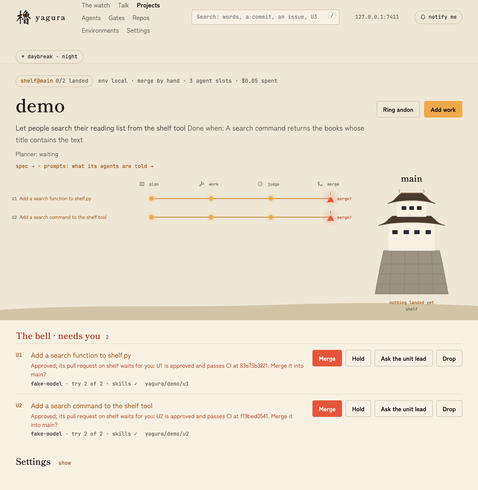
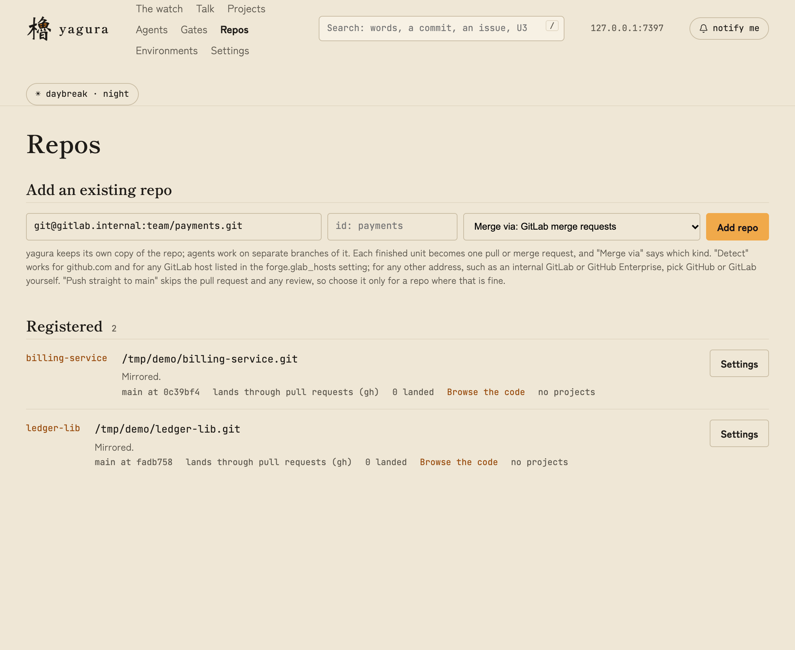
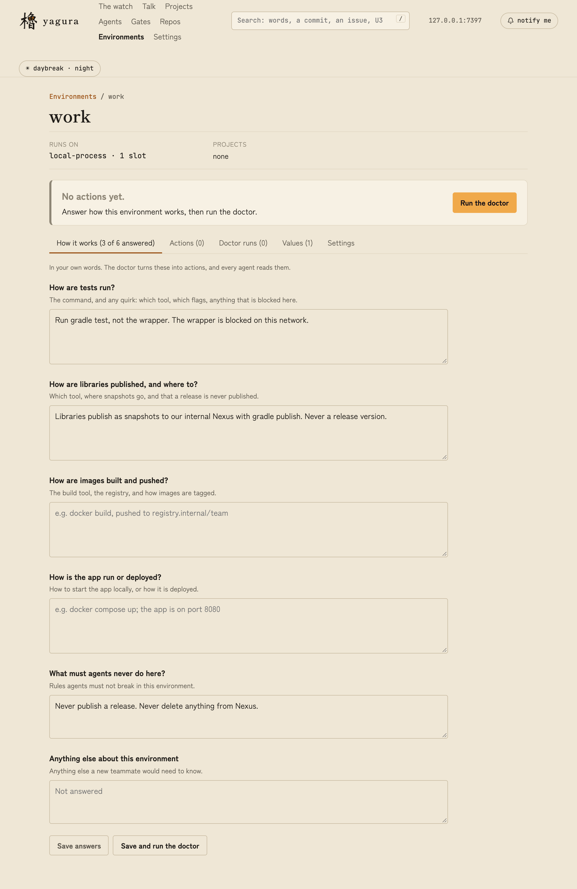
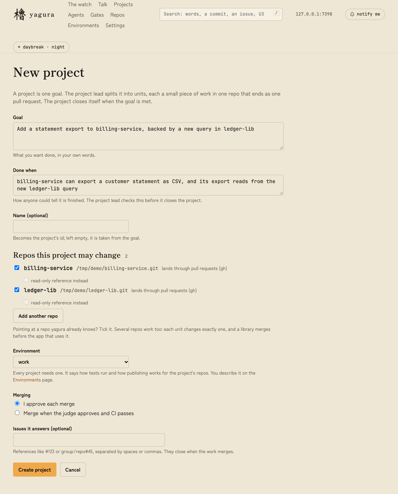
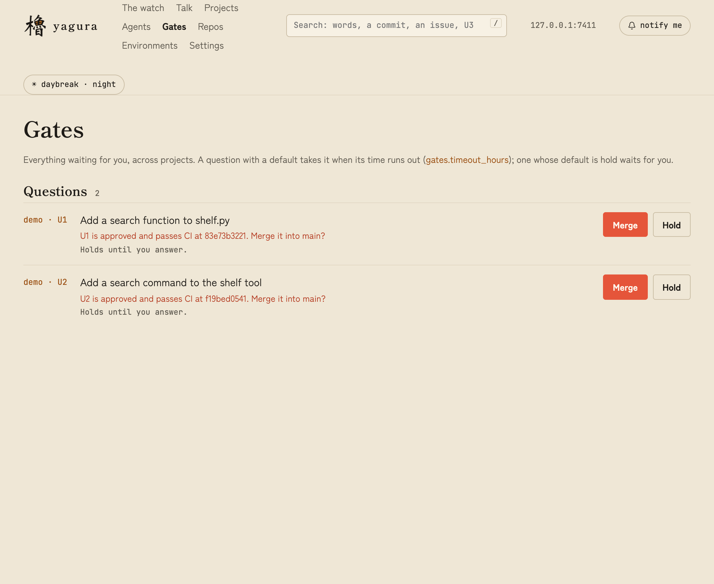
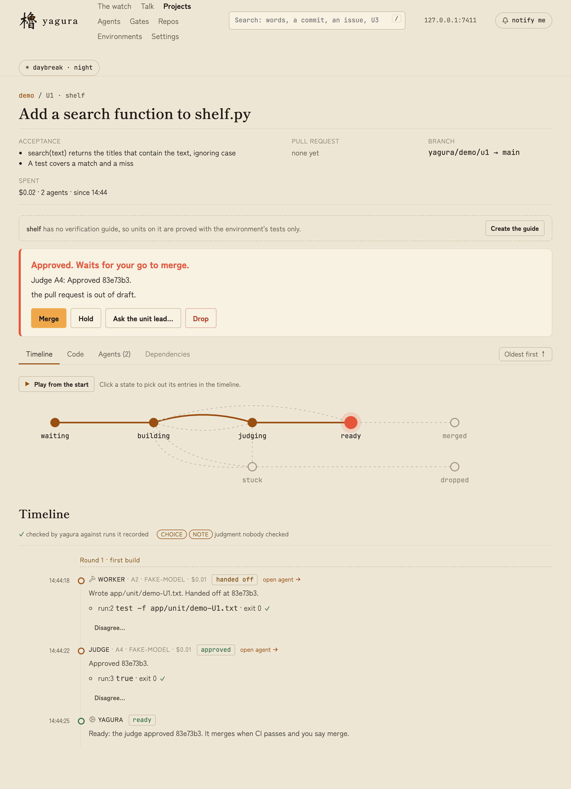

<p align="center">
  <picture>
    <source media="(prefers-color-scheme: dark)" srcset="yagura-dark.png" />
    
  </picture>
</p>

# yagura 櫓

Yagura runs coding agents on long engineering projects while you stay in charge. You give a project a goal. A daemon splits it into small units, runs an agent on each one in its own git worktree, and has a fresh agent judge the result against test runs the daemon recorded itself. Each unit ends as one pull request, and nothing merges until the judge approves it and, by default, you do too.

It runs as one daemon per developer, with no cloud service. You drive it from a web dashboard.

## How it works

You set yagura up once, then each project runs the same loop:

1. **You describe a goal** and how anyone can tell it is done. The planner splits it into units, each a small change to one repo.
2. **A worker builds each unit** on its own branch, in its own checkout of the repo.
3. **A judge checks it.** A fresh agent reruns the tests and records what it saw. The daemon keeps its own record of every run, so a ✓ in the dashboard means yagura saw the command pass.
4. **You decide.** A unit that the judge approves shows up as a question on the Gates page. Merge it, hold it, or send it back. Merging is your call unless you set the project to merge by itself.

The dashboard has a page for each stage. The Projects page shows the loop for a project, Unit pages show what happened and why, and Gates is where your decisions wait.



## Install

You need Node 26 (`.nvmrc` pins it), pnpm 11, git 2.38 or newer, a logged-in `claude` CLI, and `gh` or `glab` for pull or merge requests.

```sh
git clone https://github.com/ultish/yagura && cd yagura
scripts/setup.sh
yagura start
```

`scripts/setup.sh` checks Node, pnpm and git, runs `pnpm install` and the build, and links `yagura` into `~/.local/bin`. It adds one marked block to your `~/.zshrc` or `~/.bashrc` that puts that directory on your PATH. It then reports whether `claude`, `gh` and `glab` are installed and logged in. You can run it again at any time. `--no-rc` leaves your rc files alone and prints the PATH line instead, `--bin <dir>` changes where the link goes, and `--uninstall` removes the link and the block.

`yagura start` runs the engine and the dashboard in the background on `http://127.0.0.1:7300`. `yagura status` shows whether it runs, `yagura stop` stops it, and `yagura restart` does both. The log is `daemon.log` in the state directory. `yagura daemon` runs it in your terminal instead, which is what a systemd unit wants. Add `--debug` (or set `YAGURA_DEBUG=1`) to log every git, gh and glab call, each agent start and exit, evidence runs, API changes, and the background polls. State lives in `~/.yagura`, or in `YAGURA_HOME` if you set it. While you experiment, point `YAGURA_HOME` at a scratch directory so you don't mix test runs into your real home.

`yagura --help` lists the everyday commands, and `yagura help all` lists every one.

### Native build

`better-sqlite3` compiles natively, so the machine needs `gcc`, `make` and Python. After any Node switch, run `pnpm rebuild better-sqlite3`.

## Configure

### Plugins

Yagura's own skills need no install. The daemon passes `plugins/yagura` to every agent session, so keep the cloned folder where it is.

Agents use your whole `claude` setup, and the default method comes from the [pstack](https://github.com/ultish/pstack-claude) plugins. Install them once, inside `claude`:

```
/plugin marketplace add ultish/pstack-claude
/plugin install pstack@pstack-claude
/plugin install cursor-team-kit@pstack-claude
```

Any other plugin or skill your work needs goes into the same `claude`, and every agent gets it. To make yagura stop a unit whose worker skipped a skill, list that skill in the `skills.work` setting.

### Your `claude` command

Yagura starts `claude` as a program, without a shell. If `claude` is a function or alias in your `.bashrc`, as it is when a proxy is wrapped around it, yagura can't see it. `scripts/setup.sh` detects this and writes `~/.local/bin/yagura-claude`, which runs your function in an interactive shell. Set `harness.claude.bin` to that path in Settings. If your rc file prints anything at startup, that text mixes into the agent's output. In that case, copy what the function does into the wrapper instead.

### Environments

An environment tells agents how things run: how tests run, where libraries are published, what must never happen. You describe it in plain words, and a doctor agent turns the description into commands and proves them.

You can fill one in on the Environments page, or let a Claude session do it. Install the yagura skills once, inside `claude`:

```
/plugin marketplace add ultish/yagura
/plugin install yagura-skills@yagura
```

In the session that's working on your project, say "create a yagura environment for this project". The skill reads your project, then creates the environment with the `yagura` command, so `yagura` has to be on its PATH.

### GitLab

Log in with `glab auth login --hostname <host>`, then add the host to the `forge.glab_hosts` setting. Repos from that host merge through merge requests. Any other host needs you to pick GitHub or GitLab when you add the repo.

### Models and budget

All settings are on the Settings page. Models default to the `claude` default. To pick one per role, set `role.worker.model`, `role.judge.model`, `role.lead.model`, `role.planner.model` and `role.doctor.model`. `project.budget_usd` caps what one project can spend.

### Reaching the dashboard from another machine

The daemon listens on localhost. To open it from another machine, start it with `YAGURA_BIND=<hostname>` (or `0.0.0.0`) and `YAGURA_PORT`, and open that port in the firewall. Beyond localhost the dashboard asks for the token in `$YAGURA_HOME/token`. Browser notifications need HTTPS, or Chrome's `unsafely-treat-insecure-origin-as-secure` flag for that address.

`yagura start` keeps running after you close the terminal. On a Mac, wrap it as `caffeinate -is yagura daemon` to keep the machine awake. For systemd, run `yagura daemon` in a user service.

### Giving the dashboard a name

A DNS name maps to an address, not a port. To open the dashboard as `http://yagura:7300` on your own machine, add a line to `/etc/hosts` as root:

```
127.0.0.1   yagura
```

To leave off the `:7300`, either put a reverse proxy on port 80, or let yagura listen on port 80 itself. A Caddyfile for the proxy:

```
http://yagura {
  reverse_proxy 127.0.0.1:7300
}
```

With nginx on RHEL, SELinux also needs `sudo setsebool -P httpd_can_network_connect 1` before it can proxy to a local port. To listen on 80 directly, run `sudo sysctl -w net.ipv4.ip_unprivileged_port_start=80`, save the same line in a file under `/etc/sysctl.d/`, and start yagura with `YAGURA_PORT=80`.

An `/etc/hosts` line only works on the machine it is in. For teammates, ask for an A record in your DNS that points the name at the VM's address, and start yagura with `YAGURA_BIND` so it listens beyond localhost (see above). A full name such as `yagura.corp.example.com` is safer than a bare `yagura`, which can collide with a search domain.

Then tell yagura its address, so pull requests and merge commits link to the right place:

```sh
yagura set yagura.url '"http://yagura"'
```

## Set up a project in the dashboard

### 1. Add the repos

On the Repos page, paste a git URL and press Add repo. "Merge via" says how finished work gets in. Detect handles github.com and any GitLab host you listed. For any other address, pick GitHub pull requests or GitLab merge requests. Push straight to main skips review, so use it only where that's fine.



### 2. Describe the environment

On the Environments page, add one with provider `local-process` to start. On its Answers tab, say how tests run and how libraries are published, then press Save and run the doctor. Put machine facts such as `NEXUS_URL` on the Values tab. The Actions tab shows the commands the doctor proved.



### 3. Create the project

Go to Projects, then New project. Write the goal and how anyone can tell it is done. Tick the repos the project may change, or add one from the same page. Pick the environment. Choose whether you approve each merge, which is the default, or let yagura merge once the judge approves and CI passes. You can also describe the goal on the Talk page and press Go on the proposal it makes.



### 4. Watch it run

Open the project. Each unit is a line that moves from plan to work to judge to merge, and a red bell means a unit is waiting for you. The questions agents have for you are on the Gates page, with the same buttons.



Click a unit to see what happened. The timeline lists each agent's work with the test runs yagura recorded, and a ✓ means yagura saw that command pass. A choice or note is the agent's own judgment, which nobody checked. The Code tab shows the change, and Agents lists what each agent cost. Merge, Hold, Ask the unit lead and Drop are at the top.



On Agents you can read a running agent's work, steer it, or stop it. A stuck unit can be retried or cancelled, and the andon button on a project stops everything.

### 5. Add a verification guide to each repo

A repo can carry a verification guide: a skill in `.claude/skills/verify-<app>/` that says how to run the app and check each feature. With one, the planner names the page that proves each acceptance line, and the judge has to drive that page before it can approve. Without one, units are proved with the environment's tests only.

A unit page says when its repo has no guide. Press Create the guide, say how to start the app and what to avoid, and yagura adds one unit to the project that writes it. The agent can't ask you questions while it works, so put what only you know in that box. You can also start it with `yagura verify create <repo> --project <id>`, or from the Repos page.

### Tracing a commit back to yagura

A merge commit names the unit (`rakko/U1`), the agents and models that built and judged it, the runs the approval rests on, who asked for the work (a trusted user's yes on an issue, or the Talk conversation), and who allowed the merge (`Approved-by`, with the merge gate and the time). The pull request description has the same, plus the commands yagura recorded and the judgment calls the agents made that nobody checked.

Set `yagura.url` to the dashboard's address and both link to the unit's page. A commit message can't be edited after it merges, so if that address may change, turn off `yagura.link_in_commits` and only the pull request keeps the link. In the repo browser, a gutter label on each block of lines shows the unit that last wrote it, and `yagura trace <sha>` gives the same from the terminal.

Logging in to `claude`, `gh` and `glab`, `yagura project set` and `yagura unit requeue` are CLI only for now.
